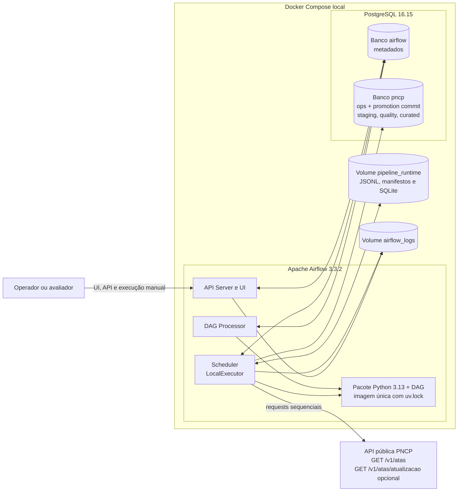

# Diagrama de componentes

> Estado: atualizado para o ambiente AS BUILT validado.

Decisões expressas:

- as tasks rodam em processos locais do scheduler, não em workers Celery;
- o dado intermediário passa pelo volume, não por XCom;
- metadados Airflow e dados de negócio usam bancos distintos no mesmo serviço PostgreSQL;
- os processos Airflow usam o mesmo ambiente Python 3.13 travado, validado em Linux ARM64;
- PostgreSQL, não o estado do Airflow, confirma atomicamente promoção, resultado e versão aceita da fonte;
- não há Redis, Kafka, Spark, triggerer ou serviço Python separado no P0.
