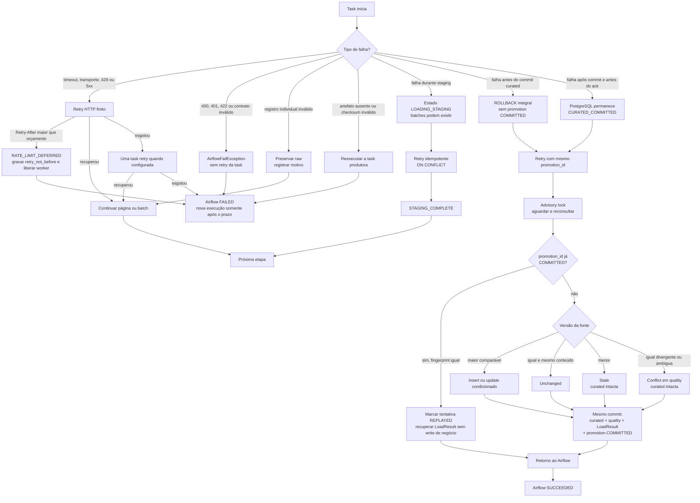

# Diagrama de falhas e recuperação

> Estado: arquitetura aprovada. O diagrama mostra o limite de sucesso, não comandos operacionais.

O commit de PostgreSQL produz `CURATED_COMMITTED`, não `SUCCEEDED`. Só o retorno posterior permite ao Airflow marcar sucesso; se essa comunicação falhar, o retry recupera o resultado durável. Staging parcial, tentativa `STARTED` e artefato incompleto nunca confirmam promoção.
