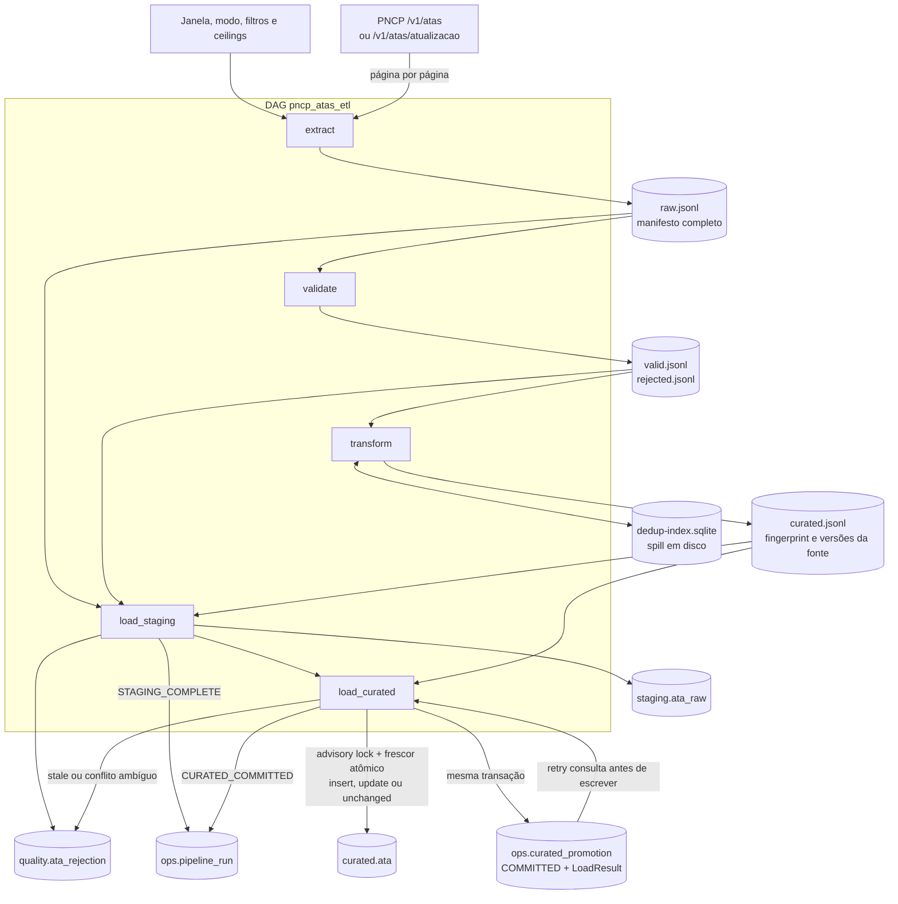

# Diagrama do fluxo ETL

> Estado: atualizado para o fluxo AS BUILT validado.

Cada seta entre tasks representa somente uma referência pequena em XCom. Os arquivos permanecem no volume compartilhado e são verificados por manifesto/checksum. O commit final torna visíveis juntos os efeitos curated/quality, `LoadResult`, `promotion=COMMITTED` e `pipeline_run=CURATED_COMMITTED`; o estado `SUCCEEDED` pertence posteriormente ao Airflow.
